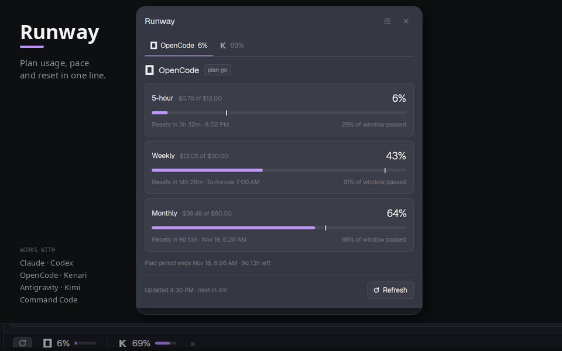

# Runway

Plan usage, pace and reset for every coding-agent subscription, in one line at
the bottom of [Herdr](https://herdr.dev).



Runway is a Herdr mod. The bar shows one item per enabled provider; the dialog
shows every window, a pace tick, and a forecast when the current rate runs out
before the reset.

## Install

Ask your agent:

> Read `~/.config/herdr-app/AGENTS.md`, then add this mod:
> `herdr.dev/mods/abuamar142/herdr-runway/runway`

Or point it at the GitHub folder:

> Read `~/.config/herdr-app/AGENTS.md`, then add this mod:
> `https://github.com/abuamar142/herdr-runway/tree/main/runway`

The agent copies both `mods/runway/` and `mods/runway-detail/` into
`~/.config/herdr-app/mods/`, then adds the bar to the layout's bottom row:

```json
{
  "id": "footer",
  "type": "row",
  "size": { "px": 28 },
  "children": [
    {
      "id": "usage",
      "type": "block",
      "size": { "weight": 1.35 },
      "min": 340,
      "content": { "mod": "runway" }
    },
    {
      "id": "status",
      "type": "block",
      "size": { "weight": 1 },
      "content": { "mod": "workspace-status" }
    }
  ]
}
```

Then:

```sh
herdr-app check ~/.config/herdr-app/mods/runway
herdr-app check ~/.config/herdr-app/mods/runway-detail
herdr-app status
```

## Providers

| Provider | Source | Needs |
|---|---|---|
| Claude | Runway key, `CLAUDE_CODE_OAUTH_TOKEN`, Claude Code's credential file, or an OAuth `anthropic` entry in OpenCode's `auth.json` | A Claude Code OAuth token; an Anthropic API key is not the same thing |
| OpenCode Go | Runway key, OpenCode's SQLite login, `~/.local/share/opencode/auth.json`, `~/.omp/agent/models.yml`, or `OPENCODE_GO_API_KEY` | An OpenCode Go API key or an OpenCode login |
| Kenari | Runway key, `KENARI_API_KEY`, `~/.kenari/credentials.json`, or `~/.omp/agent/models.yml` | A Kenari key |
| Codex | `quota-axi` | `quota-axi` or `npx`; Codex signed in |
| Antigravity | `quota-axi` | `quota-axi` or `npx`; Antigravity running/installed |
| Kimi | `quota-axi` | `quota-axi` or `npx`; Kimi signed in |
| Command Code | `quota-axi` | `quota-axi` or `npx`; Command Code signed in |

Python 3 must be on `PATH` as `python3`, `python`, or `py`.

`quota-axi` is optional. Without it, the four `quota-axi` providers show their
install/sign-in errors and the other three still work.

## Credentials

Settings → **Credentials** can store a key per provider when the tool's own
sign-in is missing or points at the wrong account. Saved keys live in
`~/.config/herdr-app/runway-keys.json` with mode `600`; they are not written to
Herdr's shared state and are never logged.

- **Claude Code** takes an OAuth token, not an Anthropic API key. Paste the
  token from `claude setup-token` or the `accessToken` in
  `~/.claude/.credentials.json`. An `sk-ant-api...` key is rejected before a
  network call.
- **OpenCode Go** takes an API key (`oc_sk_...` or `sk-...`). API keys and the
  `auth.json` entry read `https://opencode.ai/zen/go/v1/usage`; the SQLite OAuth
  login keeps reading the Console endpoint so its dollar figures stay available.
- **Kenari** takes an API key.

The panel's saved key wins over every automatic source. Clear it to fall back
to the tool's own sign-in. Codex, Antigravity, Kimi and Command Code use
`quota-axi`'s own sign-in and have no key field.

## Use

- Click a provider in the bar to open the dialog on its tab. Click `»` for the
  last selected provider.
- Each provider shows a **History** card for its primary window: 24h or 7d
  sparkline, burn rate, and the projected end at reset. It builds as Runway
  refreshes.
- In the dialog: `←`/`→` step providers, `1`–`9` pick one, `R` refreshes,
  `S` opens settings, `Esc` closes.
- The gear opens settings: **Providers**, **Credentials**, **Refresh**,
  **Alerts** and **Bar** are separate tabs.
- Credentials: paste a key, press Save (or Enter), use Show/Hide, **Test** to
  validate it without saving, and Clear to return to automatic detection. Each
  row also shows which source the last read used and its HTTP status.
- Refresh: choose 5, 10, 15, 30, 60 minutes, or Manual.
- Alerts: choose warn/critical percentages, forecast and reset toasts, or
  snooze for an hour. **Send test** posts one toast.
- Bar: choose which window the bar reads (`Primary`, `5h`, `Week`, `Month`,
  `Worst`), whether it shows `All`, `Critical` or `Worst`, and whether to hide
  providers with no credential.
- Providers: the `↑`/`↓` chips reorder the bar and tabs; the order survives a
  restart. The interval chip cycles Auto/5/10/15/30/60 minutes.
- Off providers are not read at all. Their last record stays as a placeholder
  so you can switch them back on; switching one on runs one read.
- Auto refresh defaults to 5 minutes. Each provider can override it: the chip
  in **Providers** cycles Auto/5/10/15/30/60 minutes; Auto follows the global
  setting. A manual refresh reads every enabled provider regardless.

## Privacy

The collectors read credentials that already exist on this machine and use
them only as `Authorization` headers. Tokens are never printed or logged. If
you save a key in the panel, it is stored in
`~/.config/herdr-app/runway-keys.json` with mode `600`; otherwise nothing is
written by Runway. **Test** writes the pasted key to a short-lived
`runway-test-*.json` with mode `600`, asks the helper with `--only-key`, and
deletes it. Only normalized numbers and the credential source name are written
to Herdr's shared state. The history file keeps seven days of normalized
percentages in `~/.config/herdr-app/runway-history.json`; it contains no
tokens.

Network endpoints:

- `https://api.anthropic.com/api/oauth/usage`
- `https://opencode.ai/console/api/go/status`
- `https://opencode.ai/zen/go/v1/usage`
- `https://kenari.id/v1` (or `KENARI_BASE_URL`)
- `quota-axi` through `npx` when it is not installed globally

The mod runs Python programs with `exec`. Install it only if you trust the
code in `runway/mods/`.

## Uninstall

Remove `~/.config/herdr-app/mods/runway/` and
`~/.config/herdr-app/mods/runway-detail/`, and remove the `runway` block from
the layout. Delete `~/.config/herdr-app/runway-keys.json` if you saved keys.
Herdr keeps the `runway.*` shared keys; they are harmless.

## License and marks

MIT. See [LICENSE](LICENSE).

Provider marks belong to their owners. Claude and OpenCode marks come from
Simple Icons (CC0); Codex, Antigravity, Kimi, and Command Code marks come from
Lobe Icons; the Kenari mark is drawn for this mod. This project is not
affiliated with any of those providers.
