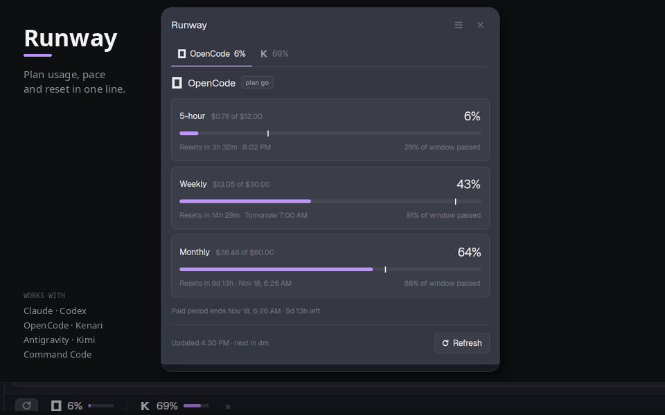

# Runway

Plan usage, pace and reset for every coding-agent subscription, in one line at
the bottom of Herdr. Click a provider to open a dialog with every window, a
pace tick showing how much of the window has already passed, and a forecast
when the current pace runs out before the reset.



## What you see

**The status bar** is a 28px strip across the bottom of the window, drawn on
`chrome` with a 1px `border` top edge. From left to right:

- A 12px refresh glyph in a 6×2px rounded button. It spins while a read is in
  flight.
- One item per enabled provider, separated by a 1×12px `border` divider. Each
  item is a 6×2px rounded hover target with a 13px provider mark, the primary
  window's percentage at 12px semibold, and a 28×4px mini meter. The meter's
  track is `foreground` at 16% opacity; its fill is `accent` below 75%,
  `working` from 75%, `blocked` from 95%.
- A blocked provider shows a `blocked` `!` instead of a meter. A provider whose
  last read is more than two refresh intervals old dims to 55% opacity.
- A dim `»` opens the dialog.
- The rest of the row is empty, so the bar can sit beside `workspace-status`.

The bar's empty state says `Runway ···`; clicking it opens the dialog.

**The dialog** is 520px wide and as tall as its content, on `popover` with
16px padding and 12px gaps. Top to bottom:

- Header: `Runway` at 15px semibold, a 28px settings button, and a 28px close
  button. In settings the title becomes `Settings` and the settings button
  becomes an accent `Done` chip.
- A tab row: each tab has a 14px mark, the short provider name only when
  active, and the primary percentage. The active tab has a 2px `accent`
  underline across the full tab width. A blocked provider shows `!`.
- Body: one provider. The provider header has an 18px mark, its name at 15px
  semibold, and a small `raised` plan badge. Each window is a `raised` card with
  a 1px `border`, 8px radius and 12px padding:
  - Top line: window name (`5-hour`, `Weekly`, `Monthly`, or the collector's
    label), the dollar pair when the window reports money, and the headline
    percentage or dollar amount at 18px semibold.
  - A 10px track holding a 6px bar. A 2px `foreground` tick marks how much of
    the window's time has passed.
  - A bottom line: `Resets in 3h 32m · 8:02 PM` on the left; on the right,
    either `29% of window passed` or `Limit in ~2h 25m at this pace` in
    `working` when the current rate runs out before the reset.
- A blocked provider replaces the cards with a `blocked` card tinted at 10%,
  carrying the error, the action, and the collector's failure detail.
- Footer: `Updated 4:30 PM · next in 4m` (or `manual refresh`) and a Refresh
  button with a 12px glyph that spins while busy.

**Settings** replaces the body with three tabs: `Providers`, `Credentials`
and `Refresh`.

- `Providers`, with one row per known provider: mark, name, plan, current
  reading, and a 34×20px switch. Off rows are dimmed.
- `Credentials`, with one row for Claude Code, OpenCode Go and Kenari. Each row
  has a 16px mark, the name, a one-line hint, a `Saved`/`Not set` status, a
  30px masked input, and `Show`, `Save` and (when saved) `Clear`. A footnote
  says Codex, Antigravity, Kimi and Command Code use `quota-axi` sign-in, and
  names the key file.
- `Refresh`, with chips `5m 10m 15m 30m 60m | Manual`. The active chip has an
  `accent` border and an 18% `accent` fill. The hint reads
  `Every 5 minutes · next in 3m` or `Reads only when you press Refresh.`

## How it behaves

- Clicking a provider item in the bar stores that provider id and opens the
  dialog on its tab. Clicking `»` opens the last selected provider.
- Clicking a tab switches provider and remembers it. `←`/`→` step through the
  enabled providers; `1`–`9` select by position; `R` refreshes; `S` toggles
  settings. `Esc` closes the dialog through Herdr's own overlay handling.
- Hovering a provider item shows its name, plan, every window, and each reset.
  Hovering the pace tick says how much of the window has passed.
- The Refresh button runs the same read as the bar's refresh glyph. A read
  updates the snapshot, clears the busy flag, and re-renders every mod.
- Saving a credential writes `~/.config/herdr-app/runway-keys.json` with mode
  `600`, clears the input, marks the row `Saved`, and runs one refresh.
  Clearing deletes that provider's entry and runs one refresh; the collector
  falls back to the tool's own sign-in.
- A saved key overrides every automatic source. With no saved key, Claude
  reads `CLAUDE_CODE_OAUTH_TOKEN`, then Claude Code's credential file, then an
  OAuth `anthropic` entry in OpenCode's `auth.json`. OpenCode reads its SQLite
  OAuth login, then `auth.json`, then OMP's `models.yml`, then
  `OPENCODE_GO_API_KEY`. Kenari reads `KENARI_API_KEY`, then
  `~/.kenari/credentials.json`, then `models.yml`.
- OpenCode keys and `auth.json` entries use
  `https://opencode.ai/zen/go/v1/usage` and return percentages only. The SQLite
  OAuth login keeps using the Console endpoint, so its dollar figures stay.
- Saving a key for a provider that is off writes the key but skips the read;
  the row says `Saved` and the provider stays hidden.
- Auto refresh is 5 minutes by default and never below 5. The next read is
  scheduled from the snapshot's `fetched_at`, so a manual read postpones it.
  `Manual` disables periodic reads; the dialog still refreshes on demand.
- Turning a provider off hides it from the bar and tabs and **skips its
  collector entirely**. Its last record stays in the snapshot as a placeholder
  so the row can be turned back on; turning it on triggers one immediate read.
- A failed read replaces that provider's data with an error record; other
  providers keep their data. The bar shows `!`; the dialog shows the error card.
- Windows with no reset time show `No reset time`. Providers with no reading
  show `No reading yet.` A provider that reports dollars but no percentage gets
  its percentage from `used_usd / limit_usd`.

## Built from

Two mods, installed together:

- `mods/runway/` — the status-bar mod. `main.js` owns the snapshot, the
  schedule, the collectors, and the bar. `format.js` holds the shared
  formatting, pace math, and settings helpers. `mod.json` is
  `{ "place": "none", "size": 28 }`.
- `mods/runway-detail/` — the dialog. `main.js` draws the tabs, cards,
  settings, and keyboard handling; its own `format.js` copy must stay
  identical to the bar's. `mod.json` is
  `{ "place": "none", "size": 28, "overlay": { "width": 520 } }`.

`format.js` is duplicated because a mod cannot import from outside its own
folder. Keep the two copies byte-identical.

The bar reads providers with `exec` on `python`/`python3`/`py`, one helper per
source:

- `runway_keys.py` — reads one provider's entry from Runway's key file; a
  missing or malformed file is not an error.
- `collect_claude.py` — reads a saved token, `CLAUDE_CODE_OAUTH_TOKEN`, Claude
  Code's `.credentials.json`, or an OAuth `anthropic` entry in OpenCode's
  `auth.json`; calls `https://api.anthropic.com/api/oauth/usage`.
- `collect.py` — reads a saved key, OpenCode's SQLite `credential` table,
  `~/.local/share/opencode/auth.json`, `~/.omp/agent/models.yml`, or
  `OPENCODE_GO_API_KEY`. API keys call
  `https://opencode.ai/zen/go/v1/usage`; the SQLite OAuth login calls
  `https://opencode.ai/console/api/go/status`.
- `collect_kenari.py` — reads a saved key, `KENARI_API_KEY`,
  `~/.kenari/credentials.json`, or the `kenari` block in
  `~/.omp/agent/models.yml`; calls `https://kenari.id/v1` (or
  `KENARI_BASE_URL`).
- `collect_quota_axi.py` — runs `quota-axi` (or `npx -y quota-axi`) with
  `--provider codex,agy,kimi,commandcode --json`, filtered to the enabled
  providers.

Every helper answers `--json` with
`{ provider|id, name|title, plan, windows[], money, period_ends_at, error,
code, action, failure }`. The bar normalizes that to
`{ id, name, plan, windows, money, period_ends_at, updated, error, code, action,
failure }`.

Herdr functions used: `shared`, `setShared`, `exec`, `appHome`, `openOverlay`,
`closeOverlay`, `props`, `run`, `nextCommand`, `theme`, `readTextFile`,
`writeTextFile`, `notify`. GPUI pieces: `View`, `div`, `svg`, `h_flex`,
`v_flex`, `Input`, `InputState`, `cx.timer`, `cx.spawn`, `cx.focus_handle`,
`track_focus`, `on_key_down`.

The credential file is:

```json
{
  "claude": "eyJ...",
  "opencode-go": "oc_sk_...",
  "kenari": "sk-..."
}
```

It lives outside the mod folders, so a mod update never overwrites it. The bar
passes `--keys-file <path>` to the three helpers that accept it; keys never
appear in argv or shared state.

Shared state:

- `runway.snapshot` — `{ fetched_at, providers[] }`
- `runway.settings` — `{ refresh_minutes, manual_only }`
- `runway.busy` — boolean
- `runway.detail.selected` — provider id
- `runway.enabled` — array of provider ids; absent means all

The mod carries a one-time fallback for the enabled list from
`usage-unified.enabled`, the name it used
before it was called Runway.

The status bar belongs in the layout's bottom row. The shape used here:

```json
{
  "id": "footer",
  "type": "row",
  "size": { "px": 28 },
  "children": [
    {
      "id": "usage",
      "type": "block",
      "size": { "weight": 1.35 },
      "min": 340,
      "content": { "mod": "runway" }
    },
    {
      "id": "status",
      "type": "block",
      "size": { "weight": 1 },
      "content": { "mod": "workspace-status" }
    }
  ]
}
```

If the layout has no footer row, add one at the end of the root column with a
28px height and put the `runway` block in it. The detail mod is never placed in
a layout; the bar opens it with `openOverlay`.

## Watch out

- **Both folders are required.** `runway-detail` is not optional: the bar's
  `openOverlay` names it.
- The folder names are load-bearing. `runway` appears in the layout's
  `content.mod`, `MOD_DIR`, `MOD_PATH`, `DETAIL_MOD`, `ASSETS`, the overlay
  name, and the shared keys. Renaming one without the others breaks the bar.
- The bar must be a block in a layout; it is not a floating overlay. Its
  `mod.json` only declares `place` and `size`.
- `format.js` exists twice. Edit one, copy it to the other.
- The app rewrites `gpui-kit.d.ts` and `jsconfig.json` on start; they are not
  shipped.
- The dialog's keys need the dialog to hold focus. The mod creates a focus
  handle in `init`, tracks it on the root, and focuses it after 80ms. Older
  app versions without `track_focus`/`on_key_down` will still draw and click,
  but the keys may do nothing. `Esc` is Herdr's, not the mod's.
- The pace tick only appears for known window keys: `five_hour`, `fiveHour`,
  `seven_day`, `week`, `month`. `month` is treated as 30 days. Unknown keys
  still get a bar and reset line, just no pace tick.
- The runout forecast is suppressed until 10% of the window has passed, and
  only shows when 100% would be reached before the reset.
- Claude's usage endpoint can rate-limit repeated reads. The 5-minute default
  and `Manual` exist for that. A rate-limited read is an error card, not stale
  numbers.
- The collectors read local credentials. They never print tokens, but they do
  reach the network: Anthropic, OpenCode, Kenari, and `npx` for `quota-axi`.
  Say so before installing.
- A saved key is plaintext on disk with mode `600`, like
  `~/.kenari/credentials.json`. Anyone who can read the user's home can read
  it. `chmod` is skipped on Windows, where the profile ACL applies.
- Claude's field is an **OAuth token**, not an Anthropic API key. The collector
  rejects `sk-ant-api...` before a request; subscription usage cannot be read
  with an API key.
- OpenCode's `auth.json` can hold an expired key while the SQLite OAuth login
  still works. The collector tries SQLite first, then `auth.json`, so an
  expired saved key does not hide a working login. A saved Runway key is
  explicit and wins; if it is expired the row shows `api_key_expired`.
- Codex, Antigravity, Kimi and Command Code have no key field because
  `quota-axi` owns their auth. A raw key pasted for them would not be used.
- `quota-axi` is optional. Without it, Codex, Antigravity, Kimi and Command Code
  show their sign-in/install errors; Claude, OpenCode and Kenari still work.
- The busy flag lives in shared state. If the bar is killed mid-read, the next
  start's first read clears it; a killed process can leave `Refreshing…` until
  then.
- The preview is composed from two real screenshots (the dialog and the bar)
  on a clean background; it is not drawn by the mod.

## Done when

- `herdr-app check ~/.config/herdr-app/mods/runway` and
  `herdr-app check ~/.config/herdr-app/mods/runway-detail` both pass.
- `herdr-app status` reports no mod errors after adding the block.
- The layout shows a 28px bar with the refresh glyph, one item per enabled
  provider, a percentage, a mini meter, and `»`.
- Clicking a provider opens the dialog on that provider; the tab underline and
  header match.
- The dialog shows one card per window, a reset line without seconds, and a
  pace tick; a window on track to run out shows `Limit in ~… at this pace`.
- Settings opens from the gear, switches a provider off, and the bar loses that
  item. A read while it is off does not run that provider's collector.
- Credentials shows three rows; saving a key marks it `Saved`, writes
  `~/.config/herdr-app/runway-keys.json` with mode `600`, and refreshes that
  provider. Clearing removes the entry and returns to automatic detection.
- A Claude `sk-ant-api...` value is rejected as the wrong credential type. An
  expired OpenCode key reports `api_key_expired` with the Console action.
- Turning it back on runs one read and restores the item.
- Changing Auto refresh to `Manual` stops periodic reads; Refresh still works.
- A provider with a bad credential shows `!` in the bar and an error card in
  the dialog, while the other providers still show their numbers.
